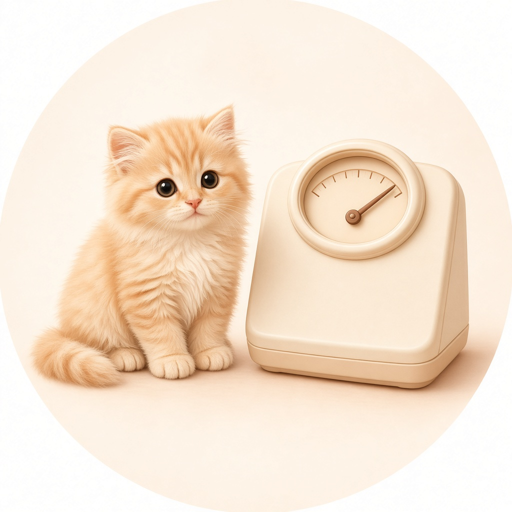
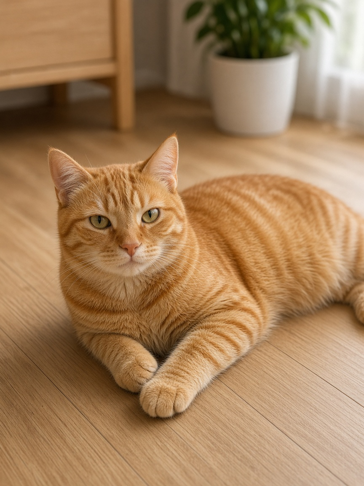
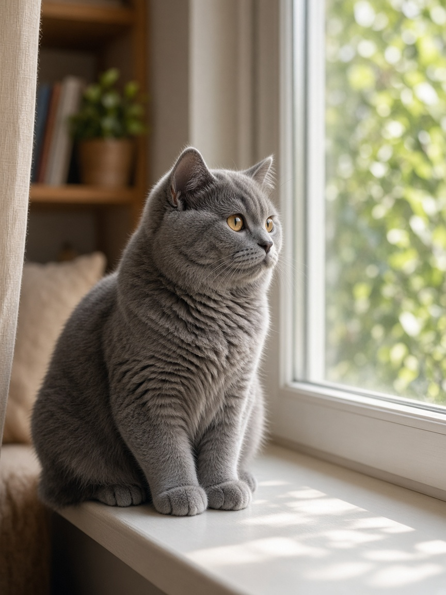
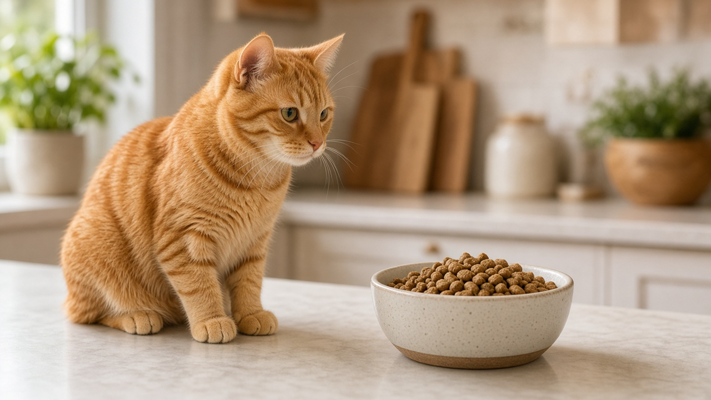
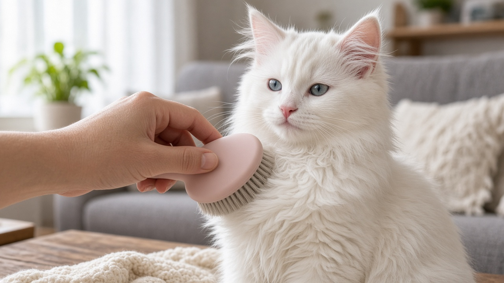
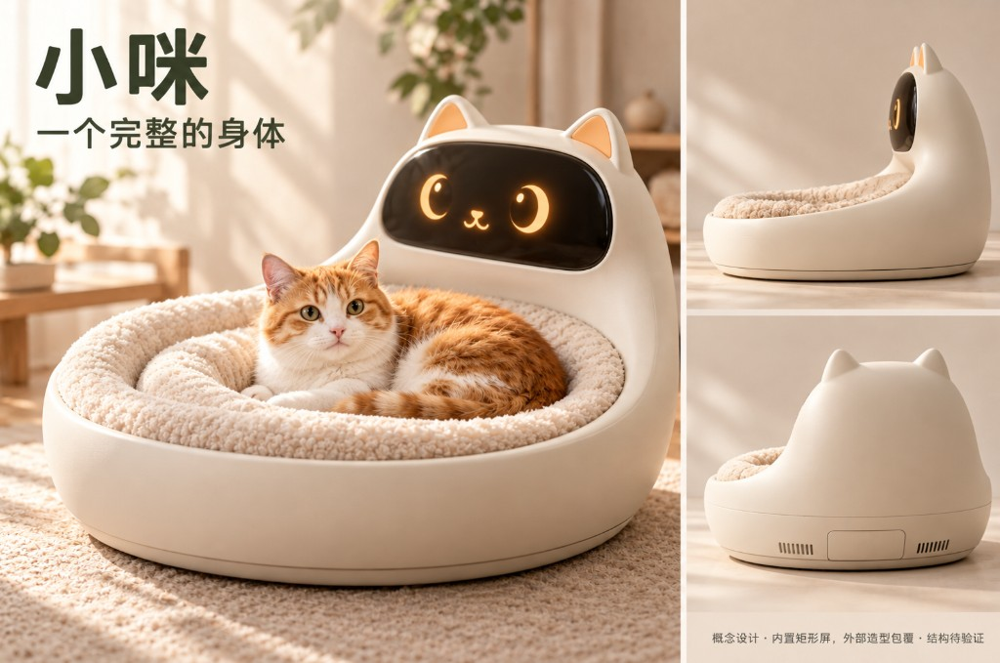
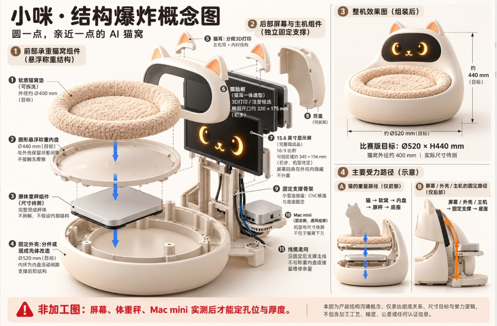

# 小咪 · AIdol S2

> **陪伴式宠物体重管理** Web 原型 · 京东 Aidol 创造营 S2  
> 把「称重 → 陪伴 → 健康洞察 → 社区发现」串成一条完整产品故事。

<p align="center">
  
  &nbsp;
  
  &nbsp;
  
</p>

<p align="center">
  <a href="https://aidol-s2.vercel.app"><b>🚀 在线体验</b></a>
  &nbsp;·&nbsp;
  <a href="https://github.com/chimeraHHH/aidol-s2">GitHub 主仓</a>
  &nbsp;·&nbsp;
  <a href="https://github.com/chx0506/xiaomi-app">备份仓</a>
</p>

---

## 目录

- [项目简介](#项目简介)
- [在线演示](#在线演示)
- [产品截图](#产品截图)
- [功能地图](#功能地图)
- [信息架构与路由](#信息架构与路由)
- [设计语言](#设计语言)
- [快速开始](#快速开始)
- [技术栈](#技术栈)
- [目录结构](#目录结构)
- [架构与扩展](#架构与扩展)
- [数据与 Mock](#数据与-mock)
- [部署（Vercel）](#部署vercel)
- [AIdol S2 赛题背景](#aidol-s2-赛题背景)
- [协作说明](#协作说明)
- [License](#license)

---

## 项目简介

**小咪**是面向宠物主人的移动端 Web 原型：把体脂秤称重能力，和「回家跟猫咪说说话」的情感陪伴放在同一条体验链上。

| 维度 | 说明 |
|------|------|
| 形态 | React + Vite SPA；桌面端 iPhone 手机框，窄屏全屏 App |
| 定位 | AIdol S2 路演 / 交互演示层（非生产固件） |
| 数据 | Mock：`localStorage` + 体重仿真序列 |
| 视觉 | 奶油暖色、可可棕强调、卡片磨砂玻璃、近乎不透明底栏 |
| 在线 | https://aidol-s2.vercel.app |

**一句话叙事：**  
主人用秤「见面」称重 → 健康页看趋势 → 陪伴页和咪酱聊天 → 发现页逛宠友与知识 →「我的」管理档案与设备。

---

## 在线演示

| 环境 | 地址 |
|------|------|
| Production | https://aidol-s2.vercel.app |
| 源码 | https://github.com/chimeraHHH/aidol-s2 |

建议用手机浏览器打开，或桌面端拉窄窗口体验全屏；宽屏会看到带 Dynamic Island 的手机框。

---

## 产品截图

### 陪伴 · 和「小咪」聊天

沉浸式陪伴页：房间氛围、猫咪形象、对话气泡与输入栏。  
演示「称完体重，回家和猫咪说说话」的情感闭环。

<p align="center">
  
  &nbsp;
  
</p>

配套动态资源：

<p align="center">
  
</p>

### 首页 · 宠窝场景

首页（`/home1`）承接宠窝内容流：通知、搜索、发帖等入口，以及宠物状态卡片。

<p align="center">
  
  &nbsp;
  
  &nbsp;
  
</p>

### 健康 · 体重趋势与生活指标

健康 Tab 以体重曲线为主（日 / 月 / 年），并展示食欲、睡眠、活动等生活方式指标。

<p align="center">
  
  &nbsp;
  
  
  
</p>

### 发现 · 宠友内容与知识卡

社区帖子 + 养护知识（饮食、梳毛、饮水、玩耍、睡眠、健康等）。

<p align="center">
  
  
  
  
</p>

### 我的 · 档案与设备

猫咪档案横幅、亲密度、设备连接与隐私开关，承接「硬件 + 软件」叙事。

<p align="center">
  
</p>

### 硬件意象 · 小米体脂秤

路演时把「秤」和 App 放在同一视觉语境。

<p align="center">
  
  &nbsp;
  
  &nbsp;
  
</p>

---

## 功能地图

| 模块 | 能力要点 |
|------|----------|
| **首页** | 宠窝主页、通知 / 搜索 / 发帖入口、宠物状态 |
| **陪伴** | 与小咪对话（规则回复 Mock）、TTS 标记、场景氛围 |
| **健康** | 体重序列图、日/月/年切换、生活方式指标、称重入口 |
| **发现** | 社区帖、知识卡片、用户头像墙 |
| **我的** | 档案、亲密度、设备连接、隐私 / 展示偏好 |
| **称重流** | `/weigh` 见面测量流程（独立页，不占 Tab） |
| **子流** | 通知中心、发帖、搜索 |

---

## 信息架构与路由

### 底部导航（5 Tab）

| Tab | 路由 | 说明 |
|-----|------|------|
| 首页 | `/home1` | 宠窝首页 |
| 陪伴 | `/` | 对话陪伴（默认入口） |
| 健康 | `/trends` | 体重与健康 |
| 发现 | `/discover` | 社区与知识 |
| 我的 | `/settings` | 档案与设置 |

### 其它路由

| 路径 | 说明 |
|------|------|
| `/weigh` | 称重见面流程 |
| `/notifications` | 通知中心 |
| `/compose` | 发帖 / 创作 |
| `/search` | 搜索 |
| `/companion` | 重定向到 `/` |
| `/paimomo/*` | 重定向到 `/home1` |

```text
┌──────────────────────────────────┐
│           Status Bar             │
├──────────────────────────────────┤
│                                  │
│        页面内容（可滚动）          │
│                                  │
├──────────────────────────────────┤
│   首页 · 陪伴 · 健康 · 发现 · 我的  │  ← 近乎不透明底栏
└──────────────────────────────────┘
```

---

## 设计语言

- **色板**：雾化奶油底 `#f2f0ed` 系 + 可可棕强调 `#6b4235` + 暖茶点缀 `#c48a5a`
- **字体**：Outfit + PingFang SC（数字用等宽感数字字体栈）
- **圆角**：大圆角卡片（约 20–28px），胶囊按钮
- **玻璃**：页面卡片使用半透明白 + `backdrop-filter`；**底部导航近乎不透明**，避免正文透出干扰可读性
- **令牌**：统一写在 `app/src/app/styles/tokens.css`（含 `--xm-glass*`）

---

## 快速开始

### 环境

- Node.js **20+**（推荐）
- npm

### 安装与开发

```bash
git clone https://github.com/chimeraHHH/aidol-s2.git
cd aidol-s2/app

npm install --legacy-peer-deps
npm run dev
```

浏览器打开终端提示地址（默认 `http://localhost:5173`）。

> 使用 `--legacy-peer-deps` 是为了兼容当前依赖解析；请保留此参数。

### 脚本

| 命令 | 作用 |
|------|------|
| `npm run dev` | 本地开发（热更新） |
| `npm run build` | `tsc -b` + Vite 生产构建 |
| `npm run preview` | 预览 `dist` |
| `npm run lint` | Oxlint |

---

## 技术栈

| 层级 | 选型 |
|------|------|
| UI | React 19 + TypeScript |
| 构建 | Vite 8 |
| 路由 | React Router 7 |
| 样式 | Sass Modules + CSS Design Tokens |
| 质量 | Oxlint |
| 托管 | Vercel（SPA rewrite） |
| 数据 | 接口化 Service + Mock 实现 |

---

## 目录结构

```text
aidol-s2/
├── README.md                      # 本文件
├── app/                           # Web 应用
│   ├── public/images/             # 静态视觉（陪伴 / 健康 / 发现 / 硬件等）
│   ├── vercel.json                # SPA：全部路径 → index.html
│   ├── package.json
│   └── src/
│       ├── app/                   # 壳：路由、Provider、global / tokens
│       ├── domain/                # 领域类型
│       ├── services/
│       │   ├── interfaces/        # IDeviceService / ICatRepository
│       │   ├── mock/              # Mock BLE + LocalCatRepository
│       │   └── createServices.ts  # 组合根（换真机只改这里）
│       ├── features/
│       │   ├── home/              # 陪伴对话（/）
│       │   ├── home1/             # 首页（嵌入 PaiHome）
│       │   ├── trends/            # 健康 / 体重
│       │   ├── discover/          # 发现
│       │   ├── settings/          # 我的
│       │   ├── weigh/             # 称重流
│       │   ├── layout/            # AppLayout + 主内容区
│       │   └── paimomo/           # 通知 / 搜索 / 发帖 / 首页卡片等
│       └── shared/                # PhoneShell、TabBar、StatusBar、Button…
├── scripts/                       # 体重仿真等辅助脚本
├── _video_frames/                 # 设计参考帧（可选）
└── generated-kittens/             # 生成素材存档（可选）
```

更短的开发入口说明见 [`app/README.md`](app/README.md)。

---

## 架构与扩展

服务层用接口隔离，方便赛后接真机 / 真后端：

1. **接真实硬件**：实现 `IDeviceService`，在 `createServices.ts` 注入。  
2. **接后端**：实现 `ICatRepository`，替换 `LocalCatRepository`。  
3. **新页面**：在 `features/<name>` 新增，挂到 `app/router.tsx`，必要时加 Tab。  
4. **改视觉**：优先改 `tokens.css`，避免散落魔法数。

```ts
// app/src/services/createServices.ts（示意）
export function createServices() {
  return {
    device: new MockDeviceService(),   // → 换成真实 BLE 实现
    cat: new LocalCatRepository(),     // → 换成 API Repository
  }
}
```

---

## 数据与 Mock

- 猫咪档案、设备状态、陪伴亲密度、测量记录：Mock + `localStorage`
- 健康页体重曲线：可由 `scripts/generate_kitten_weight_sim.py` 生成后供 `features/trends/data` 使用
- **体脂率等健康相关展示仅为原型演示**；若改为人工录入，请在 UI 标明数据来源

---

## 部署（Vercel）

当前生产配置：

| 项 | 值 |
|----|-----|
| 项目名 | `aidol-s2` |
| Root Directory | `app/` |
| Framework | Vite |
| Install | `npm install --legacy-peer-deps` |
| Build | `npm run build` |
| Output | `dist` |
| SPA | `vercel.json` rewrite → `/index.html` |

推送 `main` 到 GitHub 后，在 Vercel 触发生产部署（或通过 Vercel CLI / MCP）。  
生产地址：https://aidol-s2.vercel.app

---

## AIdol S2 赛题背景

本仓库同时作为京东 Aidol 创造营 S2 的项目存档。赛前规划中的硬件链路包括：

- 承重训练台 / 坐垫压力开关、7 寸宠物屏、Mac mini  
- ESP32 采集（压力占用、体脂秤 BLE、串口 JSON）  
- UVC 摄像头动作识别（深蹲 / 踏步）与语音提醒  

**本仓库已交付的是 Web 演示层。** 硬件联调与固件以实物记录为准，尚未全部接入本代码库。

---

## 协作说明

| Remote | 地址 |
|--------|------|
| 主仓库 | https://github.com/chimeraHHH/aidol-s2 |
| 备份 | https://github.com/chx0506/xiaomi-app（私有） |

提交作者建议使用已绑定 GitHub 的邮箱，或：

```text
140527484+chx0506@users.noreply.github.com
```

这样贡献记录会正确显示头像（避免灰色默认头像）。

本仓库本地可配置：

```bash
git config --local user.name "Daisy"
git config --local user.email "140527484+chx0506@users.noreply.github.com"
```

---

## License

仅用于 AIdol 创造营展示与学习交流。  
第三方素材（产品图、社区配图、生成图等）版权归原作者所有，请勿用于商业分发。
